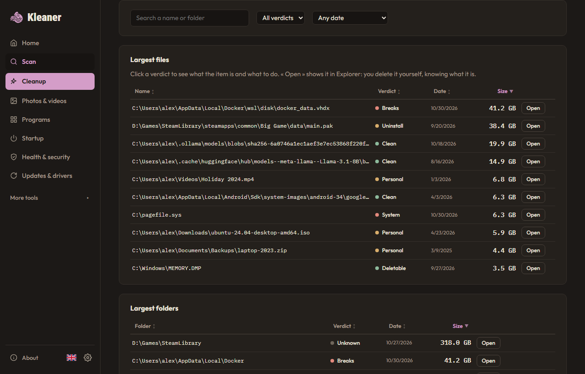

# Kleaner

[English](README.md) · **Français**

[](https://github.com/Swaksm/Kleaner/releases) [](LICENSE) [](https://github.com/Swaksm/Kleaner/releases)

**Un nettoyeur Windows gratuit qui te dit ce que tu peux supprimer, et ce qui casse si tu le fais.**

**[Télécharger Kleaner pour Windows 10 et 11](https://swaks.org/fr/kleaner/)** (installateur ou version portable, gratuit).



Kleaner analyse tes disques, explique ce qui prend la place, et nettoie ce qui est sans risque : caches, fichiers temporaires, restes de programmes désinstallés, vieux dossiers de projets. Tu restes connecté partout et tu ne perds ni fichier ni réglage. Gratuit, open source (MIT), sans compte, sans pub, sans télémétrie.

## Pourquoi Kleaner

- **Il explique.** Chaque gros fichier et dossier a un verdict (supprimable, à nettoyer avec son outil, à désinstaller, casse quelque chose, tes fichiers, système, inconnu) avec ce que c'est, ce qui se passe si tu le supprimes et comment libérer la place proprement. 109 règles écrites à la main dans [`knowledge.json`](src-tauri/knowledge.json) ; sans règle, le verdict est « inconnu » : Kleaner ne devine jamais.
- **Il est prudent.** Tes fichiers vont seulement à la Corbeille, et le Journal peut les restaurer. La suppression définitive se limite à une liste publique de caches ([`cleaners.json`](src-tauri/cleaners.json) et le catalogue communautaire filtré [`winapp2.json`](src-tauri/winapp2.json)), vérifiée en Rust ([`guard.rs`](src-tauri/src/guard.rs)) et couverte par des tests. Rien n'est coché d'avance, et « Voir la liste exacte » montre chaque fichier avant toute suppression.
- **Il est discret.** Aucun réseau (sauf une vérification de mise à jour facultative, désactivée par défaut), aucune télémétrie, aucun compte. Il ne touche jamais à tes mots de passe, cookies, sessions ou historique.
- **Il connaît les PC de développeurs, de joueurs et d'IA.** `node_modules`, `.venv`, `target`, `.gradle` des projets pas touchés depuis des mois (avec la commande qui les recrée), disques Docker et WSL, émulateurs Android, modèles Ollama, LM Studio et Hugging Face, caches PyTorch et conda, launchers de jeux (Steam, Epic, Riot, EA, Ubisoft, GOG, Battle.net) et instances de modpacks Minecraft. Sur le PC de l'auteur : 25 Go de vieux projets et 8 Go laissés par un Arduino désinstallé.

<p>
   
   
</p>

## Ce que fait Kleaner

- **Analyse** les disques que tu choisis : espace libre, plus gros fichiers et dossiers, répartition par type, carte du disque. Tri par taille, nom ou date, filtres par nom, verdict ou ancienneté. En mode administrateur sur NTFS, Kleaner lit directement la table des fichiers (en lecture seule) : environ 4 à 10 fois plus vite (2 s au lieu de 8 à 21 s sur un disque système de 420 Go).
- **Nettoyage** : 46 éléments intégrés et environ 1100 du catalogue communautaire, chacun disant ce qu'il supprime et ce que ça change. Les nettoyages lourds (Windows.old, DISM, CompactOS…) créent d'abord un point de restauration Windows. [Liste complète](docs/catalog.fr.md).
- **Conseils** (règles simples, sans IA) : installeurs téléchargés il y a plus de 30 jours, archives déjà extraites, jeux Steam pas lancés depuis 6 mois.
- **Vieux projets**, **doublons**, **photos et vidéos** (avec visionneuse intégrée) : libère de la place là où toi seul peux juger, avec un filet de sécurité.
- **Programmes** : désinstallation par le désinstalleur officiel, taille réelle, date du dernier lancement ; retrouve les restes de programmes désinstallés et les entrées mortes de la liste ; retire les applis préinstallées (Candy Crush, Actualités, Xbox…) d'une liste fermée, pour ton compte seulement, réinstallables depuis le Store.
- **Démarrage** : ce qui se lance avec Windows et la durée des derniers démarrages. Désactiver un élément ne supprime rien et se défait.
- **Santé et sécurité** (lecture seule) : disques, batterie, plantages, redémarrage en attente, antivirus, pare-feu, Secure Boot, BitLocker… Chaque alerte ouvre l'écran de Windows qui la règle. Pas un antivirus.
- **Raccourcis cassés**, **Cloud** (OneDrive et Dropbox : garder les gros fichiers en ligne uniquement), **Mises à jour et pilotes** (Windows Update et winget, sur clic).
- **Journal** de chaque action, **rapport pour une IA** (facultatif, hors ligne : un résumé Markdown à coller dans l'IA de ton choix), 8 langues, thèmes clair et sombre.

## Télécharger

1. Va dans [Releases](https://github.com/Swaksm/Kleaner/releases) et télécharge `kleaner.exe` et `kleaner.exe.sha256`.
2. Vérifie l'empreinte (PowerShell). Elle doit être identique au contenu de `kleaner.exe.sha256` :

```powershell
(Get-FileHash kleaner.exe -Algorithm SHA256).Hash.ToLower()
```

3. Lance `kleaner.exe`. Rien à installer : c'est un exe portable. Windows 10 ou 11 en 64 bits. La langue se change dans *Settings → Language*.

Tu préfères un installateur ? Télécharge plutôt `kleaner-setup.exe` (même vérification avec `kleaner-setup.exe.sha256`) : il installe Kleaner dans Program Files avec un raccourci dans le menu Démarrer, et se désinstalle depuis *Paramètres Windows → Applications*. Au premier lancement, Kleaner demande la langue, le thème, la vérification des mises à jour et le démarrage avec Windows.

Ou avec Scoop :

```powershell
scoop bucket add kleaner https://github.com/Swaksm/Kleaner
scoop install kleaner/kleaner
```

**Avertissement Windows (SmartScreen).** L'exe n'est pas encore signé (un certificat coûte cher pour un projet gratuit, et les programmes de signature pour l'open source demandent d'abord plus d'étoiles). Windows affiche « Windows a protégé votre ordinateur » : clique sur *Informations complémentaires* puis *Exécuter quand même*. Certains antivirus peuvent réagir parce que Kleaner supprime des fichiers et peut demander les droits admin. Tout le code est lisible ici, et l'exe est construit par GitHub Actions à partir de ce code : l'empreinte ci-dessus prouve que tu as bien cette version.

## Ce que Kleaner ne fait jamais

- Agir sans ta confirmation.
- Toucher à tes mots de passe, cookies, sessions ou historique.
- Nettoyer ou « réparer » le registre. Il n'y écrit que sur ta demande, et seulement deux choses : l'interrupteur d'un programme au démarrage, et le retrait d'une entrée de programme morte (sauvegardée d'abord dans un fichier .reg, restaurable depuis le Journal).
- Se connecter à Internet : **aucune télémétrie, aucune mise à jour automatique**.
- Demander les droits admin sans que tu cliques sur « Analyse complète (admin) ».
- Supprimer définitivement quoi que ce soit hors de la liste publique de caches. Les fichiers personnels vont toujours à la Corbeille.

## Aide à l'améliorer

- **Kleaner affiche « inconnu » pour quelque chose que tu reconnais ?** Clique sur son verdict, puis *Proposer une règle* : un formulaire GitHub s'ouvre dans ton navigateur, pré-rempli sans ton nom d'utilisateur. Tu le relis et tu décides de l'envoyer ou non. Voir [docs/rules.md](docs/rules.md) (en anglais).
- **Un bug ?** *À propos → Signaler un problème* prépare un rapport sans chemins personnels.
- Un cache absent du catalogue ? Ouvre un ticket avec le dossier et une source qui montre qu'il se supprime sans risque.

## Retirer Kleaner

*Paramètres → Retirer Kleaner* efface `%LOCALAPPDATA%\Kleaner` et `%LOCALAPPDATA%\com.swaksm.kleaner`. Supprime ensuite `kleaner.exe` (portable). Avec l'installateur, le désinstalleur de Windows s'ouvre juste après. Si tu as activé le démarrage avec Windows, coupe-le d'abord dans les Paramètres.

## Développement

```bash
npm install
npm run tauri dev
npm test
npm run lint
cargo test --manifest-path src-tauri/Cargo.toml
cargo clippy --manifest-path src-tauri/Cargo.toml --all-targets -- -D warnings
npm run tauri build -- --no-bundle
```

Prérequis : Node 22+, Rust stable, Visual Studio Build Tools (C++). Spécification : [SPEC.md](SPEC.md). Avant chaque release : [docs/release-checklist.md](docs/release-checklist.md). Les captures viennent d'un mode démo avec de fausses données (`src/demo`) :

```bash
npm run demo:build
npm run demo:shots
```

## Crédits et licences

Créé par [swaks](https://github.com/Swaksm). Licence [MIT](LICENSE), sans garantie.

Le catalogue communautaire (`src-tauri/winapp2.json`) est dérivé de [Winapp2](https://github.com/MoscaDotTo/Winapp2), du projet Winapp2, sous licence [CC BY-SA 4.0](https://creativecommons.org/licenses/by-sa/4.0/). Voir [WINAPP2-NOTICE.md](WINAPP2-NOTICE.md). Tout le reste est sous MIT.
