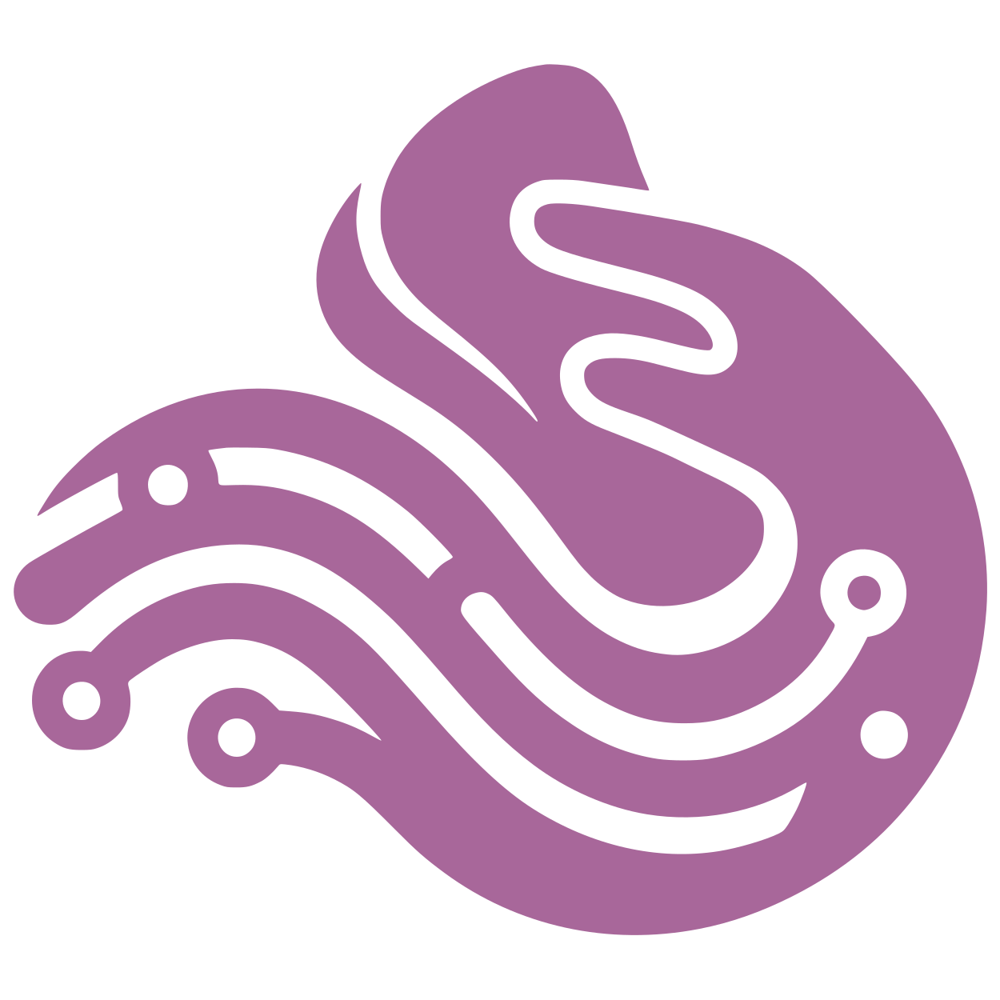
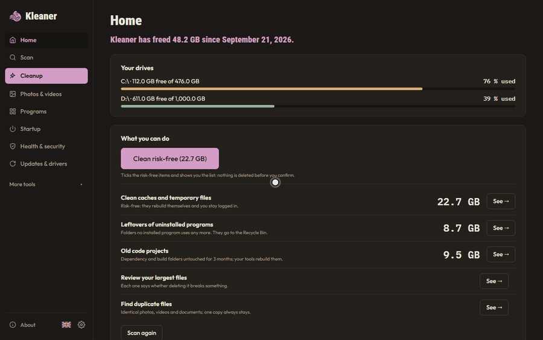
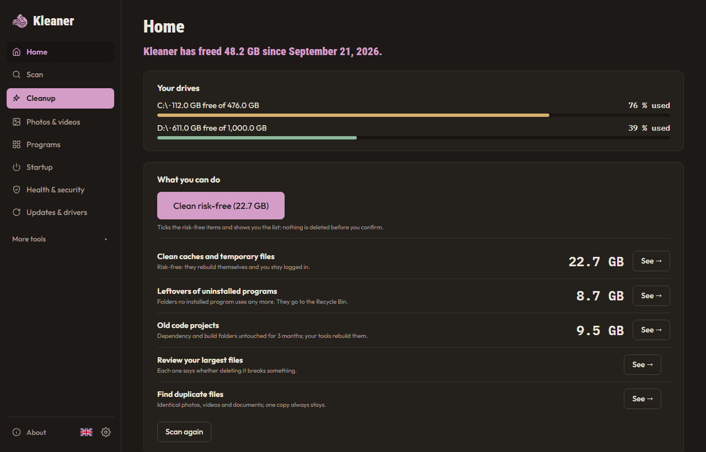
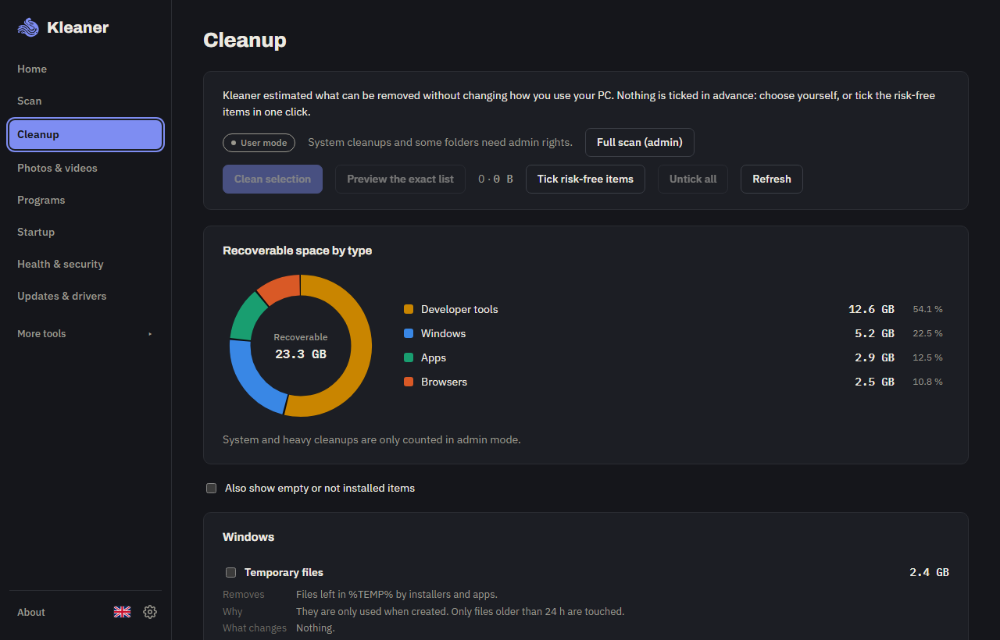
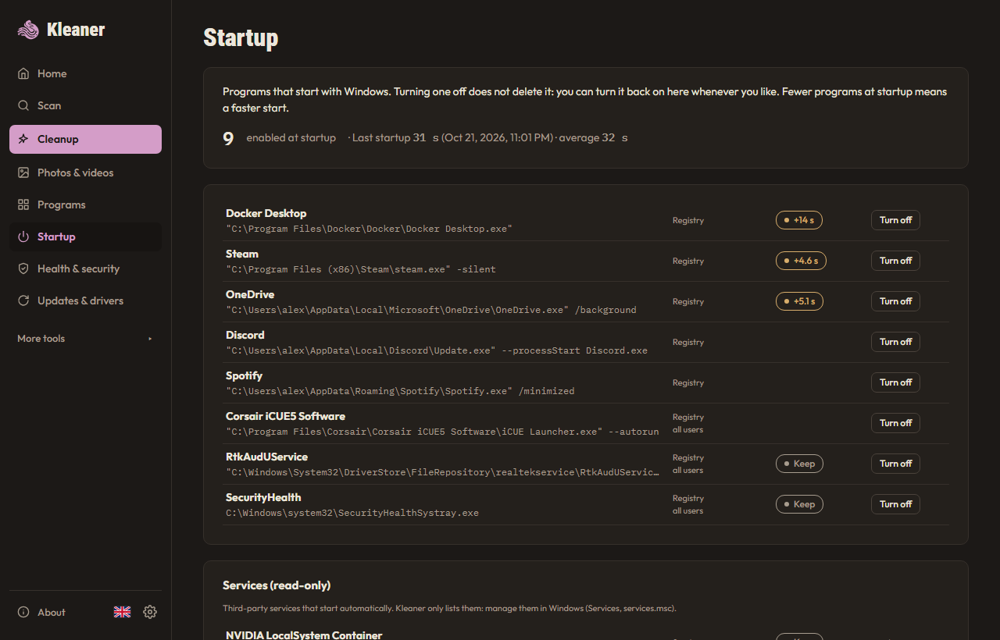
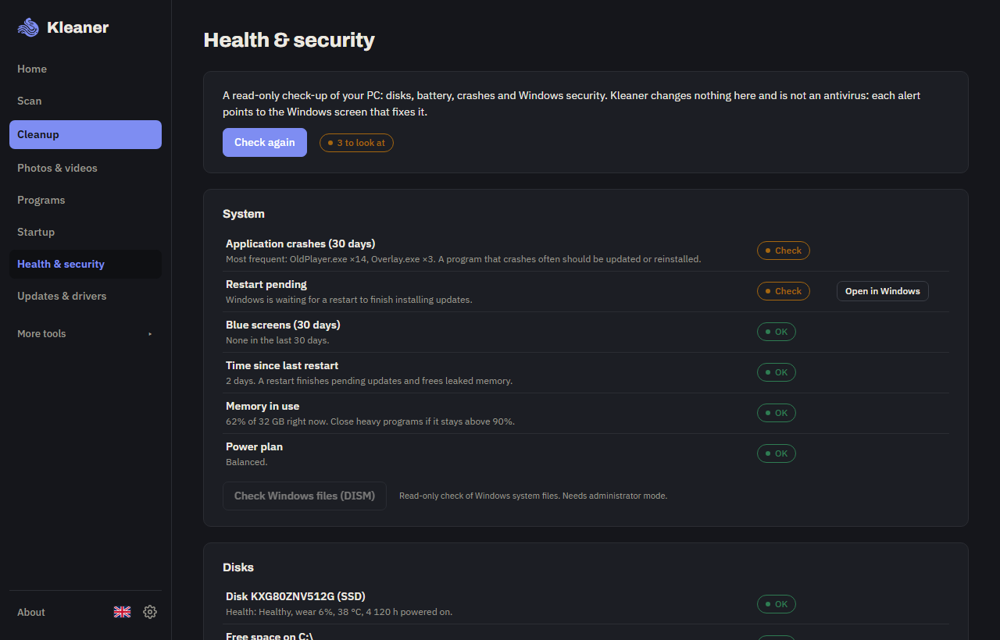

# Kleaner

**English** · [Français](README.fr.md)

[](https://github.com/Swaksm/Kleaner/releases) [](LICENSE) [](https://github.com/Swaksm/Kleaner/releases)

**A free Windows cleaner that tells you what you can delete, and what breaks if you do.**

**[Download Kleaner for Windows 10 and 11](https://swaks.org/kleaner/)** (installer or portable version, free).



Kleaner scans your drives, explains what takes up the space, and cleans what is safe: caches, temporary files, leftovers of uninstalled programs, old project folders. You stay logged in everywhere and lose no files or settings. Free, open source (MIT), no account, no ads, no telemetry.

## Why Kleaner

- **It explains.** Every large file and folder gets a verdict (safe, clean with its tool, uninstall, breaks something, your files, system, unknown) with what it is, what happens if you delete it and how to free the space properly. 125 hand-written rules in [`knowledge.json`](src-tauri/knowledge.json); with no rule, the verdict is « unknown »: Kleaner never guesses.
- **It is careful.** Your files only go to the Recycle Bin, and the Log can restore them. Permanent deletion is limited to a public list of caches ([`cleaners.json`](src-tauri/cleaners.json) and the filtered community catalog [`winapp2.json`](src-tauri/winapp2.json)), enforced in Rust ([`guard.rs`](src-tauri/src/guard.rs)) and covered by tests. Nothing is ticked in advance, and « Preview the exact list » shows every file before anything is deleted.
- **It is private.** No network (only an optional update check, off by default), no telemetry, no account. It never touches your passwords, cookies, sessions or history.
- **It knows developer, gamer and AI machines.** `node_modules`, `.venv`, `target`, `.gradle` in projects untouched for months (with the command that rebuilds them), Docker and WSL disks, Android emulators, Ollama, LM Studio and Hugging Face models, PyTorch and conda caches, game launchers (Steam, Epic, Riot, EA, Ubisoft, GOG, Battle.net) and Minecraft modpack instances. On the author's own PC: 25 GB of old project folders and 8 GB left by an uninstalled Arduino.

<p>
   
   
</p>

## What it does

- **Scan** the drives you choose: free space, largest files and folders, breakdown by type, a disk map. Sort by size, name or date, filter by name, verdict or age. In administrator mode on NTFS, Kleaner reads the file table directly (read-only): about 4 to 10 times faster (2 s instead of 8 to 21 s on a 420 GB system disk).
- **Cleanup**: 46 built-in items plus about 1100 from the community catalog, each saying what it removes and what changes for you. Heavy cleanups (Windows.old, DISM, CompactOS…) create a Windows restore point first. [Full list](docs/catalog.md).
- **Tips** (simple rules, no AI): installers downloaded more than 30 days ago, archives already extracted, Steam games not played for 6 months.
- **Old projects**, **duplicates**, **photos & videos** (with a built-in viewer): free space in the places only you can judge, with a safety net.
- **Programs**: uninstall with the official uninstaller, real size on disk, last launch date; find leftovers of uninstalled programs and dead entries in the list; remove preinstalled apps (Candy Crush, News, Xbox…) from a closed list, for your account only, reinstallable from the Store.
- **Startup**: what starts with Windows and how long the last boots took. Turning an item off deletes nothing and can be undone.
- **Health & security** (read-only): disks, battery, crashes, pending restart, antivirus, firewall, Secure Boot, BitLocker… Each alert opens the Windows screen that fixes it. Not an antivirus.
- **Broken shortcuts**, **Cloud** (OneDrive and Dropbox: keep large files online only), **Updates & drivers** (Windows Update and winget, on click).
- **Journal** of every action, **AI report** (optional, offline: a Markdown summary you paste into the AI of your choice), 8 languages, light and dark themes.

## Download

1. Go to [Releases](https://github.com/Swaksm/Kleaner/releases) and download `kleaner.exe` and `kleaner.exe.sha256`.
2. Check the hash (PowerShell). It must match the content of `kleaner.exe.sha256`:

```powershell
(Get-FileHash kleaner.exe -Algorithm SHA256).Hash.ToLower()
```

3. Run `kleaner.exe`. Nothing to install: it is a portable exe. Requires 64-bit Windows 10 or 11.

Prefer an installer? Download `kleaner-setup.exe` instead (same check with `kleaner-setup.exe.sha256`): it installs Kleaner in Program Files with a Start menu shortcut, and uninstalls from *Windows Settings → Apps*. On first launch, Kleaner asks for the language, theme, update check and whether to start with Windows.

Or with Scoop:

```powershell
scoop bucket add kleaner https://github.com/Swaksm/Kleaner
scoop install kleaner/kleaner
```

**Windows warning (SmartScreen).** The exe is not signed yet (a certificate is expensive for a free project, and code-signing programs for open source ask for more stars first). Windows shows "Windows protected your PC": click *More info* then *Run anyway*. Some antivirus tools may react because Kleaner deletes files and can ask for admin rights. All the code is readable here, and the exe is built by GitHub Actions from it: the hash above proves you got that build.

## What Kleaner never does

- Act without your confirmation.
- Touch your passwords, cookies, sessions or history.
- Clean or "repair" the registry. It writes there only on your request, and only two things: the on/off switch of a startup item, and the removal of a dead program entry (saved to a .reg file first, restorable from the Log).
- Connect to the Internet: **no telemetry, no automatic updates**.
- Ask for admin rights unless you click "Full scan (admin)".
- Permanently delete anything outside the public cache list. Personal files only ever go to the Recycle Bin.

## Help make it better

- **Kleaner shows « unknown » for something you recognise?** Click its verdict, then *Propose a rule*: a GitHub form opens in your browser, pre-filled without your user name. You read it and decide whether to send it. See [docs/rules.md](docs/rules.md).
- **Bug?** *About → Report a problem* prepares a report with no personal paths.
- A cache that is missing from the catalog? Open an issue with the folder and a source showing it is safe to delete.

## Removing Kleaner

*Settings → Remove Kleaner* erases `%LOCALAPPDATA%\Kleaner` and `%LOCALAPPDATA%\com.swaksm.kleaner`. Then delete `kleaner.exe` (portable). With the installer, the Windows uninstaller opens right after. If you turned on *Start with Windows*, turn it off first in Settings.

## Development

```bash
npm install
npm run tauri dev
npm test
npm run lint
cargo test --manifest-path src-tauri/Cargo.toml
cargo clippy --manifest-path src-tauri/Cargo.toml --all-targets -- -D warnings
npm run tauri build -- --no-bundle
```

Requirements: Node 22+, stable Rust, Visual Studio Build Tools (C++). Specification: [SPEC.md](SPEC.md) (French). Before each release: [docs/release-checklist.md](docs/release-checklist.md). The screenshots above come from a demo mode with fake data (`src/demo`):

```bash
npm run demo:build
npm run demo:shots
```

## Credits and licenses

Made by [swaks](https://github.com/Swaksm). MIT [license](LICENSE), no warranty.

The community catalog (`src-tauri/winapp2.json`) is derived from [Winapp2](https://github.com/MoscaDotTo/Winapp2) by the Winapp2 project, under [CC BY-SA 4.0](https://creativecommons.org/licenses/by-sa/4.0/). See [WINAPP2-NOTICE.md](WINAPP2-NOTICE.md). Everything else is MIT.
